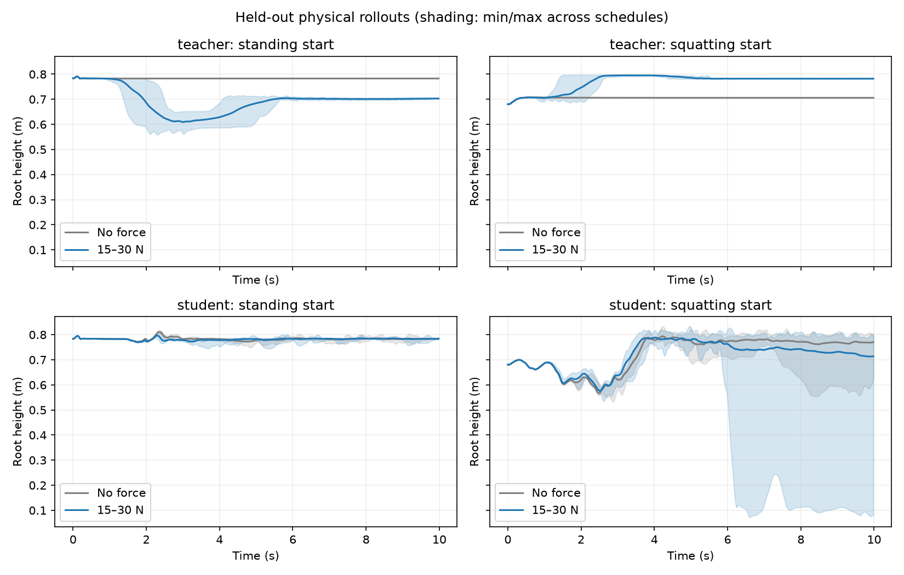

# 实验 3：Force Latent Student

## 验证目标与结论

验证同一个 Student 在不读取真实外力的条件下，能否复现 Force-aware Teacher 的 Standing ↔ Squatting 行为，并在撤力后保持姿态。**已完成两阶段共 13 轮训练及最终独立评估，行为验收未通过；不能作为可部署成功的模型。** 最终指标见 `exp03/heldout.json`，全部训练轮次见 `exp03/initial_results.json` 与 `exp03/results.json`。

## 最终独立评估结果

| 指标 | Teacher | Student |
|---|---:|---:|
| 失败/终止回合 | 0 / 64 | 32 / 64 |
| 站立起始：有力减无力末端高度 | −8.08 cm | +0.004 cm |
| 蹲姿起始：有力减无力末端高度 | +7.61 cm | −4.06 cm |
| 无力站立端点漂移 | <0.001 cm | 0.17 cm |
| 无力蹲姿端点漂移 | <0.001 cm | 7.74 cm |
| 双向行为验收 | 通过 | 未通过 |

Student 同状态 Teacher action RMSE 为 0.690（网络动作单位），latent RMSE 为 0.330；这两项只统计终止前状态。站立起始几乎不响应力；蹲姿起始的 32 个回合全部触发终止条件。失败后高度仅作诊断，不能视为有效目标姿态。最终训练损失约 0.054，也高于中间轮次，增加纯 Student 采集暴露了分布偏移，没有解决它。

最终模型是 `runs/exp03_refine/last.pt`，导出为同目录 `deploy.pt`，**两者均是失败实验产物，不是验收通过的部署模型**。未覆盖或替换实验 2 的 Teacher。Teacher checkpoint SHA-256 仍为 `d15c864c2b82cef6dadecf631927de0ceb0661588d0078ff3d9b21ddbe975856`。训练与评估进程已结束。

曲线：

## 实现

- Teacher：实验 2 的 `runs/exp02_wm_refine/last.pt`，冻结参数。
- Student：10 帧 × 93 维本体感知 → MLP(256) → GRU(128) → 32 维控制 latent → 冻结 Teacher decoder。
- 输入包括关节位置/速度、机体角速度、重力方向、历史执行动作。没有真实外力、施力计划、任务目标标签、仿真根节点位置或 Teacher reference geometry。
- 预测的是完整控制 latent，而非单独的 force residual。这是为了同时移除 Teacher 名义姿态编码器中的特权几何信息；不能把这个 latent 解读成准确的力矢量。
- Teacher 的 forward 只拆出等价的 `latent()` 方法；原模型测试通过，零力动作与原控制器最大差为 0。
- 每个 episode 开始将循环状态清零；撤力时保留。不能用施力计划或目标标签初始化循环状态。

## 训练

1. 初始蒸馏与 DAgger：4 轮，每轮 64 个 500-step 回合、12 epochs，latent/action 权重 1/0.1，学习率 3e-4。
2. 修正训练：从初始 round1 的稳定但不响应外力的 checkpoint 出发，再做 9 轮、16 epochs，动作损失权重提高为 1，学习率 1e-4。采集时 Student 动作权重从 0.2 逐步增加至 1.0。
3. 两个起始姿态，50% 无力回合；其余为 15–30 N 竖直躯干力，随机开始时间及持续时间。每轮保留并重用历史采集数据，Teacher 在实际采集状态上给出标签。终止后的样本不参与损失。
4. 冻结 decoder，优化 history encoder；50-step truncated BPTT，batch 16。全程使用干净观测、无 domain randomization。

初始离线损失下降后闭环仍会失稳，说明监督拟合不能替代部署验证。修正过程曾出现单向向下响应，但向上切换未稳定出现；中间 checkpoint 在独立施力时序下仍有失败。这里不将任何单轮局部改善当成双向成功。

## 验收协议

固定 25 N 训练诊断之外，单独使用 seed 18271 的随机施力时序和 15/20/25/30 N 四档力，Teacher 与 Student 各执行 64 个 10 秒回合。前后阶段都由 Student 自己控制；Teacher 标签仅在 Student 动作已确定后读取用于误差统计。

撤力后取最后 2 秒高度：两个方向都要求有力/无力高度差沿目标方向超过 4.5 cm，无力姿态相对 Teacher 原端点漂移小于 2.5 cm，且零终止。终止包括高度、倾斜或水平位移越界，不全等同于已经摔倒。报告 action/latent RMSE 时只统计终止前的状态。

这是无观测噪声、无参数随机化的仿真验证，非真实机器人部署。64 个回合也不代表 64 个独立训练种子。

## 输入与导出检查

`exp03/input_audit.json` 检查序列因果性、逐步与整段编码一致性、导出与原模型数值一致性，以及 checkpoint 不含 Teacher reference encoder、goal normalizer 或施力计划。导出模型签名仅为 `(obs_history, hidden)`。接口通过不代表行为通过。

## 后续定位

现有证据支持闭环分布偏移和姿态保持失败；尚不能证明仅靠本体感知无法识别引导力。下一步应先分离名义姿态估计与慢速外力 latent，避免完整 latent 蒸馏把姿态稳定和力触发耦合；重点采集纯 Student 在施力起始阶段的状态，用 Teacher 标签纠正未触发行为，并对无力误切换单独约束。在双向干净仿真验收前，不应进入实机部署。

复现实验命令见 `experiments/exp03/README.md`。
